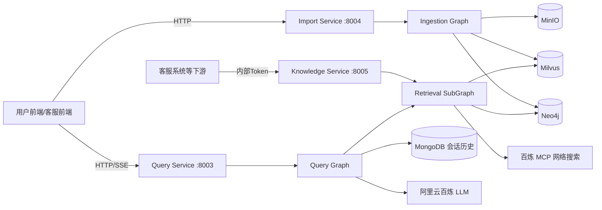
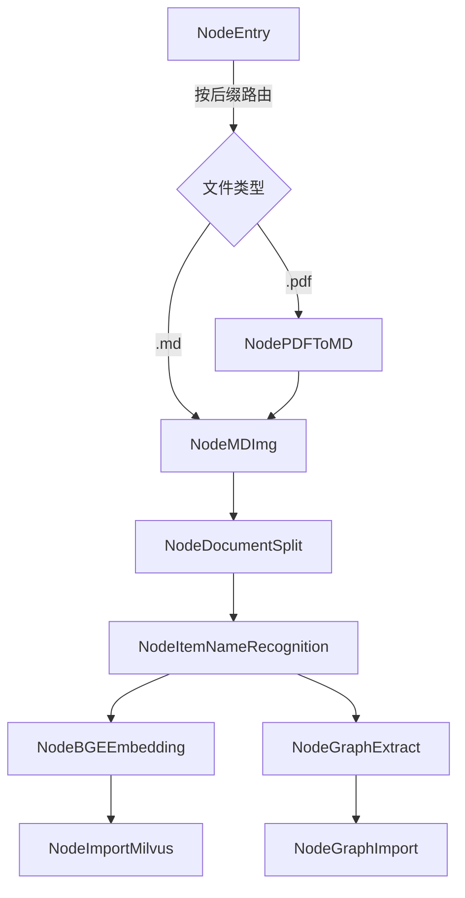
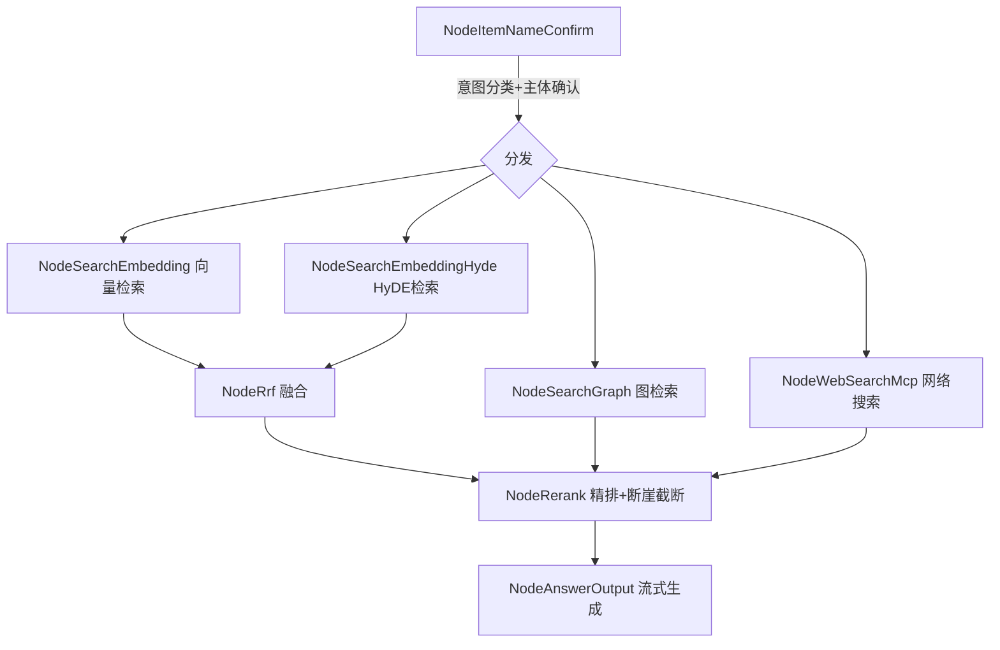

# GraphRAG 知识库项目总结与面试指南

## 目录

- [1. 项目概述](#1-项目概述)
- [2. 整体架构设计](#2-整体架构设计)
- [3. 核心数据模型](#3-核心数据模型)
- [4. 知识库构建流程（Ingestion Graph）](#4-知识库构建流程ingestion-graph)
- [5. 检索与问答流程（Query Graph）](#5-检索与问答流程query-graph)
- [6. 权重与Rerank机制](#6-权重与rerank机制)
- [7. 两个真实Bug案例复盘](#7-两个真实bug案例复盘)
- [8. 并发、异步与状态管理](#8-并发异步与状态管理)
- [9. API接口与服务拆分](#9-api接口与服务拆分)
- [10. 认证、日志与监控](#10-认证日志与监控)
- [11. 设计取舍与技术债](#11-设计取舍与技术债)
- [12. 面试高频问题](#12-面试高频问题)
- [附录](#附录)

---
## 1. 项目概述

### 1.1 项目背景

kb_0515 是一个自研的 GraphRAG（图谱增强检索）知识库系统，用于对文档（PDF/Markdown，涵盖商品说明书等领域）进行结构化摄取，并对外提供检索问答能力。项目名字借用了"GraphRAG"的概念，但**不是基于微软 GraphRAG 官方框架的二次开发**，而是用 LangGraph 手写了两条状态机（存库图 + 查询图）完全自研实现的，没有引入 Leiden 社区检测、社区摘要（community summary）等微软 GraphRAG 的标准组件。

它负责：

1. 接收文档（PDF/Markdown），完成格式转换、图片理解、切分；
2. 识别文档主体（商品名称/品牌/型号等），并向量化建立索引；
3. 从文本中抽取实体关系三元组，构建知识图谱；
4. 对用户问题做多路并行召回（向量检索、HyDE检索、图检索、网络搜索）；
5. 融合、精排、动态截断后交给 LLM 生成流式回答；
6. 对外暴露独立的"知识检索接口"，供客服等下游系统直接调用检索片段。

### 1.2 核心业务目标

- 文档摄取过程中，图片、表格、代码块等特殊内容不能破坏切分和语义完整性。
- 用户连续提问时，历史会话应被利用以正确改写/补全问题。
- 向量检索和图检索应该按问题类型（事实型/关系型/混合型）动态分配权重。
- 多路召回结果需要统一融合、去重、精排，且排序结果的数量应根据置信度动态截断，而不是固定 Top-K。
- 检索能力应可被其他系统（如客服系统）复用，而不必绑定"生成对话答案"这一步。

### 1.3 技术选型

- Web 框架：FastAPI（三个独立服务进程）
- 状态编排：LangGraph（存库图、查询图两套状态机）
- 模型调用：LangChain + OpenAI 兼容协议（阿里云百炼 DashScope）
- 向量库：Milvus（稠密向量 + 稀疏向量混合检索）
- 图数据库：Neo4j
- 会话历史存储：MongoDB
- 对象存储：MinIO（图片、原始文件）
- Embedding：本地 BGE-M3（FlagEmbedding，稠密+稀疏双输出）
- Rerank：阿里云 DashScope Qwen3-Rerank（Cross-Encoder 云端重排）
- 网络搜索：阿里云百炼 MCP（`bailian_web_search` 工具）
- PDF 转换：MinerU 第三方解析服务

### 1.4 项目主要功能

- 文档上传、格式转换（PDF→Markdown）、图片摘要理解与替换；
- 文档二级切分（标题切分 + 递归字符切分，兼容代码块/表格）；
- 文档主体（商品等）识别与向量化匹配、澄清话术；
- 实体关系三元组批量抽取与 Neo4j 图谱构建；
- 问题改写、意图分类与向量/图检索权重动态分配；
- 向量检索、HyDE检索、图检索、网络搜索四路并行召回；
- RRF 融合、Rerank 精排、断崖检测动态截断；
- 流式回答生成（SSE）与会话历史持久化；
- 独立知识检索接口，供内部系统（如客服）Token 鉴权调用。

### 1.5 项目技术亮点

1. 用 LangGraph 把"存库"和"查询"分别建模为可扩展的状态机，节点统一继承 `NodeBase`，具备统一的日志、任务状态、耗时统计和异常处理。
2. 图片理解采用"上下文摘要 + MinIO 回填"的方式，把视觉信息自然融入文本切片，而不是单独存储割裂检索。
3. 文档切分做了标题切分与递归字符切分的两级结合，并用状态机识别代码块围栏，避免误切。
4. 向量检索使用 Milvus 稠密 + 稀疏向量的 `WeightedRanker` 混合检索，兼顾语义召回与关键词精确匹配。
5. 引入 HyDE（假设性文档嵌入）提升语义召回能力。
6. 通过 LLM 意图分类动态分配向量检索与图检索的权重配额，而非固定策略。
7. Rerank 后采用"断崖检测"动态 Top-K，而非固定截断条数。
8. 检索能力被抽成独立子图（`RetrievalMainGraphRunner`），可被"问答服务"和"知识检索服务"两个场景复用。

---

## 2. 整体架构设计

### 2.1 系统组成



三个 FastAPI 服务是**完全独立的进程**，不是同一个 App 下的不同 Router：

- Import Service（8004）：负责文档摄取全流程；
- Query Service（8003）：负责面向终端用户的检索问答，支持 SSE 流式输出；
- Knowledge Service（8005）：新增的知识检索接口，只返回检索片段，不生成对话答案，供客服系统等下游调用。

### 2.2 目录分层

项目不是常见的 `routers/services/repositories` 三层架构，而是**按 LangGraph 流程节点组织**：

```
atguigu/
├── config/                # config.py（.env读取）、prompt.py（所有Prompt模板）
├── import_process/        # 存库阶段状态图
│   ├── base.py             # NodeBase 抽象基类
│   ├── state.py             # ImportGraphState
│   ├── import_main_graph.py # MainGraphRunner
│   └── nodes/               # entry/pdf_to_md/md_img/document_split/
│                              item_name_recognition/bge_embedding/
│                              import_milvus/graph_extract/graph_import
├── query_process/          # 查询阶段状态图
│   ├── base.py / state.py / query_main_graph.py
│   ├── retrieval_main_graph.py  # 独立检索子图（供知识服务复用）
│   └── nodes/               # item_name_confirm/search_embedding/
│                              search_embedding_hyde/search_graph/
│                              web_search_mcp/rrf/rerank/answer_output
├── tool/                    # milvus/neo4j/mongo/minio client、
│                              embedding_utils、rerank_tool、task_utils、
│                              logger、json_format_tool、build_graph_content
└── web/
    ├── api/                 # import_service.py / query_service.py / knowledge_service.py
    └── page/                # chat.html / import.html
```

所有节点继承 `NodeBase`，必须设置类属性 `name`，实现 `process(self, state)`，基类的 `__call__` 统一负责日志记录、任务状态更新、耗时统计和异常捕获；状态用 `TypedDict` 定义，所有节点读写同一个 state 字典。

### 2.3 文档摄取完整链路



### 2.4 检索问答完整链路



### 2.5 存库与查询服务的职责边界

Import Service 是知识资产的权威来源，负责把非结构化文档转化为向量索引和图谱数据；Query Service 和 Knowledge Service 都只读这些索引，不修改。Knowledge Service 复用 Query Service 里的"主体确认"和"检索子图"两个环节，但跳过了"意图分类的完整对话历史处理"和"答案生成"，因为它面向的是系统间调用而非终端用户对话。

---

## 3. 核心数据模型

### 3.1 ImportGraphState / QueryGraphState

两套状态机分别使用 `TypedDict` 定义的状态对象，在节点间传递并逐步补全字段。存库图的关键字段包括原始文件路径、转换后的 Markdown 内容、切分后的 chunk 列表、识别出的主体名、抽取出的三元组列表；查询图的关键字段包括原始问题、改写后问题、历史对话、确认后的主体名列表、`vector_weight`/`graph_weight`、四路召回结果、融合后的 RRF 结果、精排后的最终片段、流式输出的 task_id。

### 3.2 Milvus 数据结构

主 collection 的 schema 包含 `dense_vector`（FLOAT_VECTOR, 1024维）和 `sparse_vector`（SPARSE_FLOAT_VECTOR）两套向量字段，分别建 `IVF_FLAT + COSINE` 索引和 `SPARSE_INVERTED_INDEX + IP + DAAT_MAXSCORE` 索引；标量字段包括 `file_title`、`item_name`、`content` 等。另建有独立的 `item_name_collection`，专门存放文档主体名称的向量，供"主体确认"环节做模糊匹配。

入库前按 `file_title` 做幂等性删除（先 delete 再 insert），避免重复导入同一文件产生冗余数据。

### 3.3 Neo4j 图数据模型

图谱数据模型比较简化：节点统一使用 `Entity{name}` 标签，关系统一使用 `RELATES{type}` 类型，具体的关系语义（如"包含"、"导致"、"由...制造"）存储在 `type` 属性中，而不是使用 Neo4j 原生的多种关系类型区分。入库使用 Cypher `MERGE` 保证幂等：

```cypher
UNWIND $triples AS t
MERGE (h:Entity {name: t.head})
MERGE (tail:Entity {name: t.tail})
MERGE (h)-[r:RELATES {type: t.relation}]-(tail)
```

**项目没有实现社区检测（如 Leiden 聚类）和社区摘要生成**，图谱本质是"实体-关系-实体"三元组集合，查询时依靠实体名字符串匹配和关系类型过滤，属于 Local Search 风格，不具备回答"全局归纳类问题"的能力。

### 3.4 MongoDB 会话历史

按 `session_id` 存储历史消息列表，供问题改写和意图分类环节读取上下文，也在答案生成完成后追加写入最新一轮问答。

### 3.5 权重字段：vector_weight / graph_weight

`node_item_name_confirm.py` 中通过 LLM 对问题做意图分类（`factual`/`relational`/`mixed`），据此分配两个检索通道的权重配额：事实型问题偏向向量检索（0.7/0.3），关系型问题偏向图检索（0.3/0.7），混合型对半分（0.5/0.5）；分类置信度低于 0.6 时强制拉回 0.5/0.5 兜底。这两个权重当前的语义并非"参与排序打分的权重"，而是"决定 RRF 融合后各通道截断条数的配额"（详见第6节）。

---

## 4. 知识库构建流程（Ingestion Graph）

### 4.1 为什么需要状态机式的摄取流程

文档摄取涉及格式转换、图片理解、切分、主体识别、双路写入（向量库+图数据库）等多个耗时且可能失败的步骤。用 LangGraph 把整个流程建模为有向图，可以清晰地按文件类型路由（PDF 需要先转换，MD 不需要），也方便在某个环节失败时定位问题，同时基类 `NodeBase` 统一提供任务状态追踪，便于前端展示摄取进度。

### 4.2 PDF 转 Markdown

`NodePDFToMD` 调用第三方服务 MinerU：上传 PDF，轮询解析状态（最长等待 300 秒），解析完成后下载 zip 并解压，重命名为 `{file_title}.md`，交给后续统一的 Markdown 处理流程，从而让 PDF 和原生 Markdown 文档共享同一套图片理解、切分逻辑。

### 4.3 图片理解与回填

`NodeMDImg` 用正则匹配 Markdown 中的图片标签，取图片在文中位置前后各约 250 字符作为上下文（`pre_text`/`post_text`），调用视觉模型生成不超过 50 字的摘要；为避免触发第三方模型的限流，用 `deque(maxlen=300)` 实现的滑动窗口保证每分钟请求数不超过 300。摘要生成后，图片本身上传到 MinIO 得到 URL，再用正则把原图片标签替换成 `` 格式。这样处理后，图片的语义摘要就自然嵌入了文本内容里，切分和检索时不需要额外处理图片这种特殊类型。

### 4.4 文档二级切分

`NodeDocumentSplit` 采用两级切分策略：

1. 先按标题行（`^\s*#{1,6}\s+.+`）粗切成 section，同时用状态机检测代码块围栏（```` ``` ```` / `~~~`），避免代码块内部出现的 `#` 被误判为标题；
2. 对每个 section，如果长度小于 500 字符，或包含 `<table` 标签，就不再继续切分，保留完整语义单元；否则用 `RecursiveCharacterTextSplitter`（`chunk_size=500`, `chunk_overlap=50`，分隔符按段落/句号/问号/感叹号等中文标点递归尝试）进一步切成小块，并给每个子块补上所属标题前缀，保证脱离上下文后仍能被理解。

### 4.5 主体识别

`NodeItemNameRecognition` 取文档前 10 个切片、总长度截断到 10000 字符拼接后交给 LLM，识别出文档所描述的主体（商品名称/品牌/型号等）。识别出的主体名会向量化后存入独立的 `item_name_collection`，并回填到该文档所有 chunk 上，供后续"主体确认"环节做模糊匹配，也供向量检索时按主体过滤检索范围。

### 4.6 向量化与 Milvus 入库

`NodeBGEEmbedding` 以 3 个 chunk 为一批，拼接 `item_name + content` 后调用本地 BGE-M3 模型，同时产出稠密向量（1024维）和稀疏向量（token 权重字典）。`NodeImportMilvus` 按前述 schema 写入，写入前先按 `file_title` 删除旧数据保证幂等。

### 4.7 三元组抽取

`NodeGraphExtract` 是纯 LLM 抽取模式，不涉及社区检测。项目迭代中做了批量提取优化：从最初逐个 chunk 调用 LLM，改成以 4 个 chunk 为一批合并提交（用编号区分），减少 LLM 调用次数；对超过 2000 字的内容按句子边界截断；用栈匹配算法从 LLM 输出中稳健提取最外层 JSON 数组，应对 LLM 输出被包裹在代码块或存在多个数组的情况；最终按 `(head, relation, tail)` 三元组去重。

### 4.8 Neo4j 图谱写入

`NodeGraphImport` 使用 3.3 节所述的 `MERGE` 语句批量写入三元组，保证重复导入不会产生重复节点或边。

---

## 5. 检索与问答流程（Query Graph）

### 5.1 为什么要拆分多路召回

单一检索方式各有局限：向量检索擅长语义相似但对精确关键词/型号不敏感；图检索擅长实体间的确定性关系但覆盖面窄；网络搜索能补充知识库之外的信息。项目让四路检索并行执行，再统一融合精排，兼顾召回率和精确度。

### 5.2 主体确认与意图分类

`NodeItemNameConfirm` 是查询链路的入口，职责较重：

1. 结合历史会话，用 LLM 从当前问题中提取主体名并改写为独立完整的问题（`rewritten_query`）；
2. 将提取出的主体名向量化，去 `item_name_collection` 做模糊匹配，按相似度分档处理：相似度 ≥ 0.70 直接确认；0.50~0.70 返回澄清话术让用户从候选中选择；小于 0.50 返回"无法识别"；
3. 调用 LLM 判断问题类型（`factual`/`relational`/`mixed`），据此分配向量检索与图检索的权重配额（见3.5节）。

### 5.3 向量检索

`NodeSearchEmbedding` 使用 Milvus 的混合搜索，稠密向量和稀疏向量分别构建 `AnnSearchRequest`，用 `WeightedRanker(0.8, 0.2)` 融合两路结果，并按已确认的主体名过滤检索范围。

### 5.4 HyDE 检索

`NodeSearchEmbeddingHyde` 先让 LLM 基于改写后的问题生成一段假设性答案，再用"原问题+假设答案"拼接后的文本去做向量检索，利用假设答案中包含的领域词汇提升语义召回效果。

### 5.5 图检索

`NodeSearchGraph` 从问题中提取关键词，去 Neo4j 匹配相关实体和关系。关系类型聚焦商品领域（制造、包含、需要、用于等），并配合停用词过滤；关键词提取由中文连续片段、疑问句式和字母数字型号模式组合而成，同时加入降级匹配——实体一次精确匹配失败时，退化为取最短关键词重新尝试，提升鲁棒性。

### 5.6 网络搜索

`NodeWebSearchMcp` 通过阿里云百炼 MCP 协议调用 `bailian_web_search` 工具，走 `openai-agents` 库的 MCP 客户端协议，补充知识库之外的实时信息。

### 5.7 RRF 融合

`NodeRrf` 把向量检索和 HyDE 检索两路结果按 RRF 公式（`score = weight / (k + rank)`，k=60）累加融合并去重，再依据 `vector_weight` 动态决定截断条数（`rrf_limit = max(2, min(18, int(20 * vector_weight)))`），权重越高保留的向量检索结果越多。

### 5.8 答案生成

`NodeAnswerOutput` 拼装包含参考内容、历史对话、相关主体、用户问题的 Prompt，用 LLM 的流式接口逐 token 生成，通过任务队列把每个 token 推送给前端 SSE 消费；同时用正则从参考内容中提取图片 URL 去重，并将本轮问答写回 MongoDB 历史。

---

## 6. 权重与Rerank机制

### 6.1 Rerank 精排

`NodeRerank` 把 RRF 融合结果、网络搜索结果、图检索结果三路合并，统一格式化为 `{title, content, source, url}` 结构，调用阿里云 DashScope 的 Qwen3-Rerank（Cross-Encoder 方式）对全部候选统一打分排序。

### 6.2 断崖检测：动态 Top-K

排序完成后不是简单截取固定条数，而是做"断崖检测"：从最少保留 3 条到最多保留 10 条，逐个比较相邻两条的分数差，若相对差超过 20% 或绝对差超过 0.15，就在此处截断；否则最多保留 10 条。这种设计让高置信度场景返回更少但更精准的结果，低置信度场景（分数平缓下降）保留更多候选交给 LLM 判断。

### 6.3 权重的真实语义

`vector_weight`/`graph_weight` 目前并未真正参与 Rerank 的打分公式，而是通过 RRF 阶段的 `rrf_limit` 计算式间接影响向量检索通道能贡献多少条候选进入后续排序。也就是说，权重的实际作用是"检索条数配额分配"，而不是"排序权重"，这个命名和实现之间存在一定的语义错位，是项目里可以指出的设计取舍点。

---

## 7. 两个真实Bug案例复盘

### 7.1 权重不生效（commit 5870543）

**现象**：无论问题类型如何变化，向量检索和图检索的权重分配始终没有起作用。

**根因**：`NodeItemNameConfirm.get_weight()` 方法内部计算出了 `vector_weight`/`graph_weight`，但函数体末尾没有 `return`；调用处 `self.get_weight(...)` 也没有接收返回值，导致这两个权重永远不会被写入 state，下游 `NodeRrf` 取到的始终是默认值 0.5。

```python
# 修复前
self.get_weight(history_content, llm, original_query)   # 返回值被丢弃
return { ... }   # state 里没有 vector_weight / graph_weight

# 修复后
vector_weight, graph_weight = self.get_weight(history_content, llm, original_query)
return {
    ...,
    "vector_weight": vector_weight,
    "graph_weight": graph_weight,
}
```

同一次修复还重写了 `NodeRrf` 的融合逻辑：旧版本把 RRF 分数和原始相似度分数直接累加（`chunk_score = chunk.get("score") + weight/(k+idx)`），语义混乱，且 `score` 为 `None` 时会直接抛异常；新版本把 RRF 分数单独存为 `rrf_score`，原始分数另存为 `original_score`，并且截断条数改为真正依据 `vector_weight` 动态计算，而不是旧版本硬编码的 `[:10]`——这正是"权重不生效"的另一半原因：即便权重数值本身传对了，下游截断逻辑也完全没用到它。

**启示**：多返回值函数如果调用处漏接返回值，静态类型检查也很难发现；对关键中间变量最好补充单测或断言，避免"计算了但没用上"的哑逻辑长期存在。

### 7.2 图查询结果不进入 Rerank 排序（commit cc4349b）

**现象**：图检索节点明明返回了三元组结果，但最终排序输出里从未出现基于图谱的内容。

**根因**：`NodeRerank.get_merged_chunks()` 中处理 `graph_results` 的循环里，当 `doc` 非空时，本该执行的格式化拼装逻辑被写成了一行注释 `# ... 原有逻辑`，从未真正执行，导致图检索结果根本没有被 append 进 `merged_chunks` 列表，自然不会送进 Rerank API 参与统一排序。

```python
# 修复前（残缺）
for doc in graph_results:
    if not doc:
        merged_chunks.append({...空占位...})
        continue
    # ... 原有逻辑          ← 只有注释，没有真正的 append 代码

# 修复后（补全）
for doc in graph_results:
    if not doc:
        merged_chunks.append({...})
        continue
    head = doc.get("head", "")
    tail = doc.get("tail", "")
    relation = doc.get("relation", "关联")
    content = doc.get("content", "") or build_graph_content(head, relation, tail)
    if file_title and file_title != "知识图谱":
        content = f"根据《{file_title}》，{content}"
    merged_chunks.append({
        "title": head or "图关系",
        "content": content,
        "source": doc.get("source", "graph"),
        "url": doc.get("url", "")
    })
```

**前置铺垫**：在这次修复之前，项目先完成了"图查询结果 content 更符合自然语句"的优化（commit 5bab072）——原来图三元组机械拼接为 `f"{head} {relation} {tail}"`（如"HAK180 包含 主轴电机"），新增 `build_graph_content()` 函数，配合 `RELATION_PATTERNS` 字典把关系类型映射为更自然的中文句式（如"包含"关系用 `"{head} 包含 {tail}"`，"导致"关系用 `"{head} 可能导致 {tail}"`），未命中的关系类型走"A与B的关系是：R"兜底。这个函数写好后并没有立刻接入 Rerank 合并逻辑，而是被留在了注释里，直到第二天上午才真正补上调用——反映出这是一个"先搭骨架、留 TODO 占位、后续再补全"的典型迭代模式。

**启示**：`continue` 之前的注释很容易被误认为"逻辑还在，只是没写完整"，而实际上代码永远不会走到该分支的实际处理逻辑；对于并行多路召回后合并的场景，最好针对每一路单独写覆盖测试（比如"图检索返回非空结果时，最终排序结果必须包含图谱来源的条目"），才能第一时间发现某一路被静默丢弃。

---

## 8. 并发、异步与状态管理

### 8.1 伪异步：BackgroundTasks

项目没有引入 Celery/RabbitMQ 等消息队列，摄取和查询的耗时操作都是通过 FastAPI 自带的 `BackgroundTasks.add_task()` 在同一进程内后台线程执行 LangGraph 的 `.invoke()`。

### 8.2 SSE 进度推送

`tool/task_utils.py` 维护一个 `queue_dict: Dict[task_id, Queue]`（标准库 `queue.Queue`），`put_data`/`get_data` 存在忙等待（`while not queue_dict.get(task_id): time.sleep(1)`）；`/stream/{task_id}` 接口用 `StreamingResponse` 加一个无限循环从队列取数据推送给前端，实现流式回答的 SSE 输出。

### 8.3 任务状态追踪

任务运行状态、完成状态、耗时统计均保存在进程内存的全局字典中（非 Redis），`NodeBase.__call__` 统一在每个节点执行前后更新这些字典。这意味着任务状态是**进程内存态**，进程重启即丢失，多进程部署也会出现状态不一致。

### 8.4 连接单例与限流

Milvus/Neo4j/MongoDB/BGE 模型均通过全局变量做单例管理，Milvus 客户端具备健康检查重连逻辑。图片理解节点用 `deque(maxlen=300)` 的滑动窗口限制视觉模型调用频率。

### 8.5 幂等性而非事务

项目没有实现真正的分布式事务或数据库事务，Milvus 和 Neo4j 的入库都依赖"先按 key 删除旧数据再插入新数据"的幂等性删除策略来规避重复导入，而不是原子事务机制。

---

## 9. API接口与服务拆分

| 服务 | 端口 | 主要职责 | 主要接口 |
|---|---|---|---|
| Import Service | 8004 | 文档摄取 | `POST /upload`、`GET /status/{task_id}` |
| Query Service | 8003 | 检索问答 | `GET /health`、`GET/DELETE /history/{session_id}`、`POST /query`、`GET /stream/{task_id}`（SSE） |
| Knowledge Service | 8005 | 知识检索（供下游系统调用） | `POST /api/v1/knowledge/search` |

三个服务均为独立 FastAPI 进程，非同一 App 的不同 Router，且都开启了 `CORSMiddleware allow_origins=["*"]`。Knowledge Service 复用了 `NodeItemNameConfirm` 做主体确认，复用独立拆出的 `RetrievalMainGraphRunner` 子图完成检索+融合+精排，但不执行答案生成这一步，只返回检索到的原始片段，供客服等下游系统自行组织回答。检索子图在向量、HyDE、图检索三路结果全部为空时会直接跳过 Rerank 环节，避免空文档调用重排 API 造成的成本浪费和潜在报错。

---

## 10. 认证、日志与监控

### 10.1 认证现状

只有新增的 Knowledge Service 实现了鉴权：通过 Header `X-Internal-Service-Token` 传递内部令牌，使用 `secrets.compare_digest` 做等值比较以防时序攻击。**Import Service 和 Query Service 目前完全没有任何认证**，这是需要在生产环境中补齐的明显安全隐患。

### 10.2 日志

基于标准库 `logging` 配合 `colorlog` 实现终端彩色输出，没有接入文件持久化归档，也没有对接 ELK、Sentry 等日志/监控系统。

### 10.3 监控

项目没有 Prometheus/Grafana 等 APM 埋点，唯一的"监控"能力是内存态的任务状态字典和节点耗时统计，仅用于前端展示摄取/检索进度，不具备告警和历史趋势分析能力。

---

## 11. 设计取舍与技术债

1. **图谱数据模型过于简化**：所有节点统一为 `Entity{name}`，关系类型塞进属性而非使用 Neo4j 原生多关系类型，导致类型过滤只能靠字符串匹配，索引效率有限；也未做实体消歧/归一化。
2. **无社区检测与摘要**：不具备微软 GraphRAG 标准的 Leiden 聚类和 Global Search 能力，无法很好回答"全局归纳类"问题。
3. **图检索关键词提取依赖正则+停用词表的启发式规则**，本质脆弱，换一种问法很容易提取不到关键词，代码里的降级匹配也印证了设计者已意识到这个局限。
4. **任务状态和 SSE 队列均为进程内存态**，不支持多实例水平扩展，进程重启即状态清零。
5. **队列轮询用 `time.sleep(1)` 忙等待**，而非阻塞式 `Queue.get()` 或 `asyncio.Queue`，存在固定延迟和 CPU 浪费。
6. **认证机制不统一**：仅 Knowledge Service 有 Token 校验，另外两个主服务完全开放。
7. **权重语义与实现存在错位**：`vector_weight`/`graph_weight` 命名暗示"排序权重"，实际只影响 RRF 阶段的截断条数配额，未真正参与 Rerank 打分公式。
8. **测试覆盖有限**：存在针对各节点的独立调试脚本，但更接近手动运行的验证脚本，而非断言驱动、可集成 CI 的标准单元测试。

---

## 12. 面试高频问题

### 12.1 你这个项目整体是怎么工作的？

文档摄取阶段，系统把 PDF 转换成 Markdown，对图片生成摘要并回填正文，再做标题+递归字符的两级切分，识别文档主体后分别向量化写入 Milvus、抽取三元组写入 Neo4j。检索阶段，系统先确认问题涉及的主体并对问题做意图分类，动态分配向量检索和图检索的权重配额，四路（向量、HyDE、图检索、网络搜索）并行召回后做 RRF 融合与 Rerank 精排，并用断崖检测动态截断结果数量，最终交给 LLM 流式生成回答。

### 12.2 为什么不直接用微软 GraphRAG 框架？

项目定位更贴近业务的轻量图谱增强检索，微软 GraphRAG 的社区检测和全局摘要主要解决"归纳整篇文档"类问题，而这个项目的核心场景是针对具体商品等主体的事实问答和关系问答，用 LangGraph 手写状态机可以更灵活地控制每个环节（比如主体确认、动态权重、断崖截断），换取了对全局归纳类问题支持较弱的代价。

### 12.3 为什么要做主体识别和主体确认两步？

主体识别在摄取阶段完成，把每个文档归属到具体的商品等主体上，用于后续按主体过滤检索范围；主体确认在查询阶段完成，从用户问题中提取可能的主体，做模糊匹配后按相似度分档处理——高置信度直接确认，中等置信度返回澄清话术，低置信度提示无法识别。这样可以避免检索范围过宽导致召回不精确，也能处理用户提问中主体名称不完全准确的情况。

### 12.4 向量检索和图检索的权重是怎么决定的？

`NodeItemNameConfirm` 用 LLM 对问题做意图分类，区分事实型、关系型、混合型问题，分别给向量检索和图检索分配不同的权重配额，分类置信度不足时会强制回退到均等权重。需要说明的是，这个权重目前实际影响的是 RRF 融合阶段向量检索通道能贡献的候选条数，并不直接参与最终的 Rerank 打分公式，这是当前实现和字段命名之间存在的一处语义错位。

### 12.5 Rerank 之后为什么不用固定 Top-K？

因为不同问题的候选片段置信度分布差异很大：有些问题的最佳答案分数遥遥领先，保留过多低分候选反而会引入噪声干扰 LLM；有些问题分数分布平缓，过早截断可能丢失有用信息。断崖检测通过比较相邻分数差，在分数出现明显跳变的位置截断,在保底 3 条、上限 10 条之间动态决定实际保留数量。

### 12.6 项目里"权重不生效"的 bug 是怎么发现和修复的？

现象是无论问题类型怎么变化,检索结果的分配比例都没有变化。排查后发现计算权重的方法内部算出了结果但没有 return,调用处也没接收返回值,权重字段从未真正写入状态里,下游拿到的永远是默认值。同时发现下游截断逻辑本身也是硬编码固定条数,即使权重传对了也不会生效,所以这次修复同时改了两处:补上返回值传递,并把截断条数改为真正依据权重动态计算。

### 12.7 "图检索结果不进入排序"的 bug 根因是什么?

Rerank 节点里合并图检索结果的循环中,处理非空结果的分支只写了一行注释说明原本该有的格式化逻辑,却没有真正执行 append 操作,导致图检索结果从未进入候选列表。这类问题静态检查很难发现,因为语法上完全合法,只是逻辑被漏掉了,后来通过对比"图检索确实返回了结果"和"最终排序结果里没有图谱来源条目"这一现象定位到的。

### 12.8 项目的知识图谱是怎么构建的?有没有做社区检测?

图谱构建是纯 LLM 抽取三元组模式,文本切片批量提交给 LLM,抽取出 (头实体, 关系, 尾实体) 三元组后去重,再用 Cypher MERGE 语句幂等写入 Neo4j。没有做 Leiden 社区检测或社区摘要生成,节点统一用 Entity{name} 标签,关系类型作为属性存储在边上,查询时依靠实体名匹配和关系类型过滤,这是一种简化的 Local Search 风格图谱,不具备全局归纳能力。

### 12.9 系统的异步处理是怎么设计的?

没有引入消息队列,摄取和查询的耗时流程通过 FastAPI 的 BackgroundTasks 在同一进程内异步执行 LangGraph 的 invoke,任务状态和流式输出队列都保存在进程内存中,通过 SSE 接口轮询推送给前端。这个设计的局限是不支持多实例水平扩展,进程重启会丢失所有任务追踪信息,是可以在生产化时优先补齐的部分。

### 12.10 项目当前最大的技术债是什么?

主要有三类:一是图谱数据模型和关键词提取都偏简化和启发式,鲁棒性有限;二是任务状态、SSE队列缺乏持久化,不支持水平扩展;三是认证机制不统一,只有新增的知识检索接口有Token校验,另外两个面向用户的服务目前完全开放,这是生产化之前需要优先解决的安全问题。

---

## 附录

### A. 核心数据流状态速记

```text
Import Graph:
Entry → (pdf: PDFToMD →) MDImg → DocumentSplit → ItemNameRecognition
  → BGEEmbedding → ImportMilvus
  → GraphExtract → GraphImport

Query Graph:
ItemNameConfirm(意图分类+权重分配) → 并行[SearchEmbedding, SearchEmbeddingHyde, SearchGraph, WebSearchMcp]
  → Rrf(权重决定截断条数) → Rerank(统一打分+断崖截断) → AnswerOutput(流式生成)
```

### B. 技术亮点速记

- LangGraph 双状态机解耦存库与查询；
- 图片摘要回填实现多模态信息文本化；
- 标题+递归字符两级切分兼容代码块/表格；
- Milvus 稠密+稀疏混合检索；
- HyDE 假设性文档提升语义召回；
- LLM 意图分类驱动的动态权重配额；
- Rerank 断崖检测动态 Top-K；
- 检索能力抽象为独立子图，问答与检索接口双复用；
- 幂等性删除替代事务保证摄取可重复执行。

### C. 30 秒项目介绍

这是一个基于 LangGraph、FastAPI、Milvus 和 Neo4j 自研的 GraphRAG 知识库系统。它把文档摄取和检索问答分别建模为两条状态机：摄取阶段完成格式转换、图片理解、切分、主体识别、向量化和三元组抽取；检索阶段做主体确认与意图分类，并行执行向量检索、HyDE检索、图检索和网络搜索，融合精排后流式生成回答，同时对外提供独立的知识检索接口供下游系统复用。

### D. 2 分钟项目介绍

项目的核心不是简单套用某个现成的 GraphRAG 框架，而是根据实际业务场景（商品知识问答）自研了一套轻量图谱增强检索系统。

文档摄取时，PDF 会先转换成 Markdown，图片会生成摘要并回填到正文里，这样切分后的每个文本块都能保留图片语义。切分采用两级策略：先按标题粗切，再对过长的段落做递归字符切分，同时识别代码块避免误切。每个文档还会被识别出所属主体（比如具体商品型号或商品名称），主体名和正文分别向量化写入 Milvus，同时用 LLM 批量抽取实体关系三元组写入 Neo4j。

检索时，系统先确认用户问题涉及的主体，并对问题做意图分类，决定向量检索和图检索的资源配额。之后并行执行向量检索、HyDE检索、图检索和网络搜索四路召回，用 RRF 算法融合去重，再统一送入 Rerank 模型精排，通过断崖检测动态决定保留结果数量，最后交给大模型流式生成回答。

项目还把检索这部分能力单独抽成了一个子图，除了给终端用户问答服务复用，也给客服等下游系统提供了一个独立的知识检索接口，只返回检索片段不生成对话，方便被其他系统集成。

### E. STAR 面试回答模板

**Situation：** 需要针对特定领域文档（商品说明书）构建知识库，用户提问既有事实型也有关系型，检索需要兼顾语义相似度和实体关系的精确性，且检索能力需要被多个场景（对话问答、系统间调用）复用。

**Task：** 设计一套可扩展的摄取与检索流程，支持多模态内容（图片）理解、多路召回融合、动态权重分配和动态截断，并保证检索能力可被独立复用。

**Action：** 用 LangGraph 构建摄取和查询两条状态机；摄取阶段做图片摘要回填、两级切分、主体识别、双路写入向量库和图数据库；查询阶段做意图分类驱动的权重分配、四路并行召回、RRF融合、Rerank精排与断崖检测截断；把检索逻辑单独抽成子图供多个服务复用。

**Result：** 系统能够处理多模态文档摄取，检索结果综合了语义、关系和实时网络信息，排序结果数量能根据置信度自适应，检索能力被问答服务和知识检索服务两个场景成功复用；同时也在迭代中发现并修复了权重传递断裂、图检索结果丢失等真实问题。

### F. 项目复习清单

- 能画出文档摄取和检索问答的完整状态机流转图；
- 能解释 Milvus 稠密+稀疏混合检索和 Neo4j 简化图模型的设计；
- 能说明为什么没有做社区检测，以及这带来的能力局限；
- 能解释 vector_weight/graph_weight 的真实作用范围（配额而非打分权重）；
- 能复述"权重不生效"和"图检索结果丢失"两个bug的根因和修复方式；
- 能说明断崖检测动态截断的设计动机；
- 能解释为什么用 BackgroundTasks 而非消息队列，以及这个选择的局限；
- 能指出当前代码至少三个真实不足及改进方案（认证、图模型、状态持久化等）。
